# Nassau Candy · Shipping Route Efficiency Dashboard

**Factory-to-customer route analytics for a national confectionery distributor.**
An end-to-end analysis plus a Streamlit dashboard. It turns 10,194 order lines into route-level views of lead time, delay frequency, geographic bottlenecks and ship-mode trade-offs.


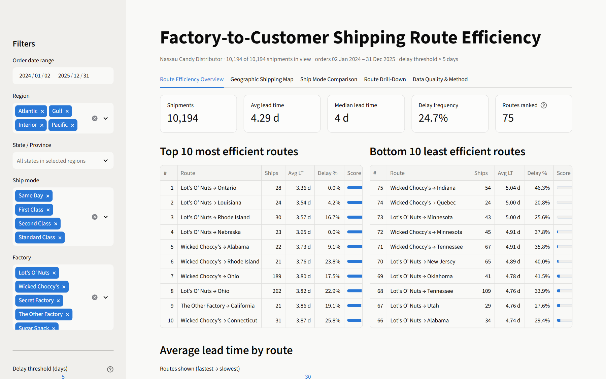

---

## Contents
- [Business problem](#business-problem)
- [Key findings](#key-findings)
- [Dashboard tour](#dashboard-tour)
- [Methodology](#methodology)
- [KPIs](#kpis)
- [Getting started](#getting-started)
- [Project structure](#project-structure)
- [Deliverables](#deliverables)
- [Limitations](#limitations)

---

## Business problem

Nassau Candy ships products from **five factories** to customers across the US and Canada. The order data is detailed, but logistics decisions have been made without route-level intelligence. This project answers:

- Which factory → customer routes are consistently efficient, and which are frequently delayed?
- How does performance vary by region, state and ship mode?
- Where are the geographic bottlenecks?
- What does faster shipping buy, relative to what it earns?

## Key findings

| # | Finding | Evidence |
|---|---|---|
| 1 | **Ship dates carried a systematic year offset.** Raw lead times of 904–1,642 days collapse to a realistic 0–11 days once corrected. | Three clusters exactly 365 days apart; the corrected values order cleanly by service level |
| 2 | **Ship mode drives speed; distance doesn't.** | Same Day 0.38 d → Standard 5.32 d; distance vs lead time Spearman ρ ≈ 0.00 |
| 3 | **System-wide slowdown in 2025.** Every ship mode got slower. | Avg 4.07 → 4.45 d; delay rate 18.1% → 29.3%; holds after controlling for mode mix (p < 0.001) |
| 4 | **Standard Class is the delay engine.** | 60% of volume, ~94% of late shipments, a wide 3–8 day window |
| 5 | **Region barely matters; a few states do.** | Region effect not significant once mode is controlled (p = 0.09). Bottlenecks: New York, Washington, Illinois, Florida, Michigan |
| 6 | **Expedited shipping isn't targeted at higher-value orders.** | Sales, profit and margin per order line are nearly identical across modes |

**Top recommendations:** fix ship-date capture at source · audit dispatch capacity at the two chocolate factories (96% of volume) before the September and holiday peaks · commit to a ≤ 5-day Standard Class SLA · work with carriers in the bottleneck states · start capturing freight cost and delivery dates.

---

## Dashboard tour

The sidebar filters every view: **order date range, region, state, ship mode, factory, delay-threshold slider, minimum shipments per route, and route definition** (Factory → State or Factory → Region).

### 1 · Route Efficiency Overview
KPI cards, the top/bottom 10 route leaderboards with efficiency scores, average lead time for every route, and monthly trends.

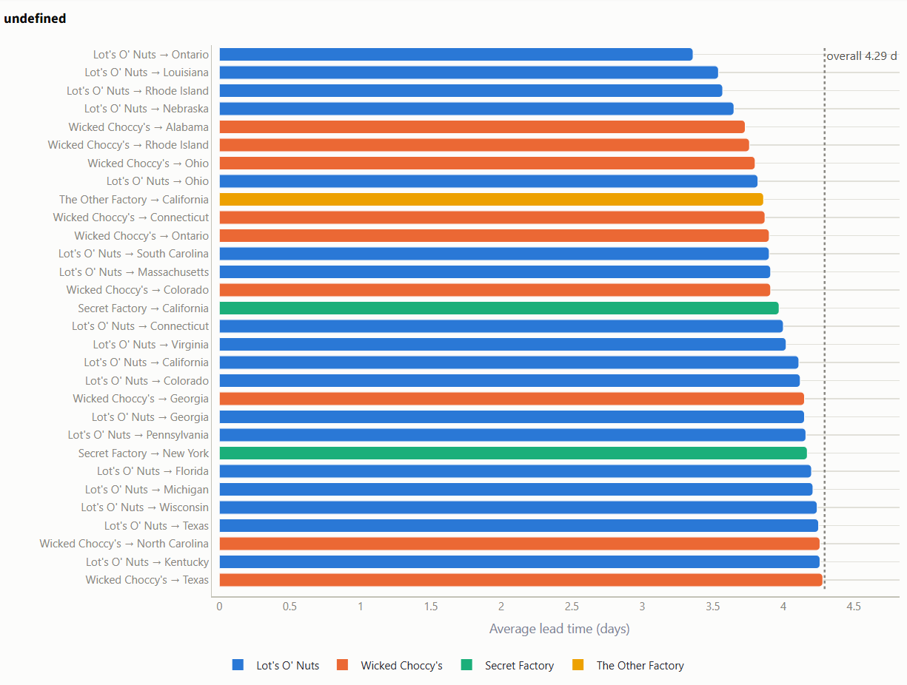
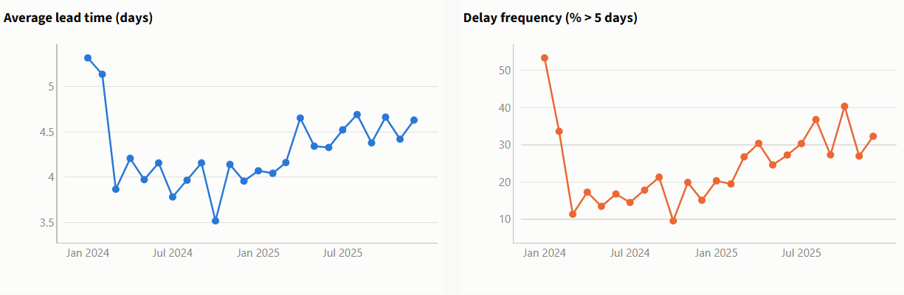

### 2 · Geographic Shipping Map
A US heatmap with a switchable metric (average lead time, delay %, mode-adjusted delay, volume) and factory locations. States below the volume minimum are grayed out so small samples can't skew the scale.

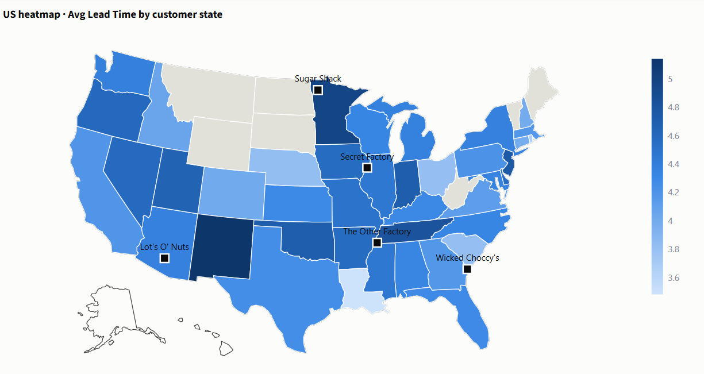

The factory → customer route network, plus the regional bottleneck view: high-volume, high-delay states are flagged in red.

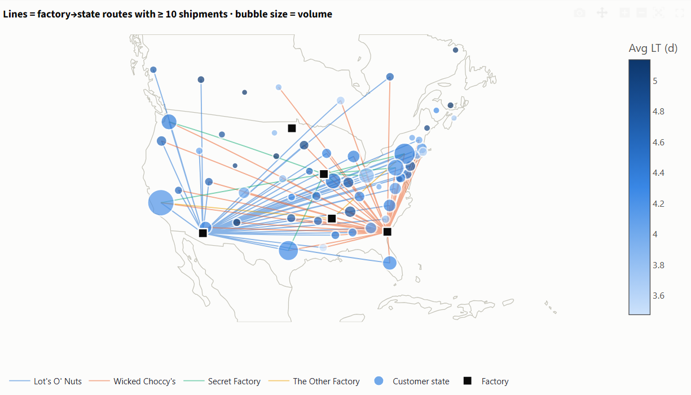
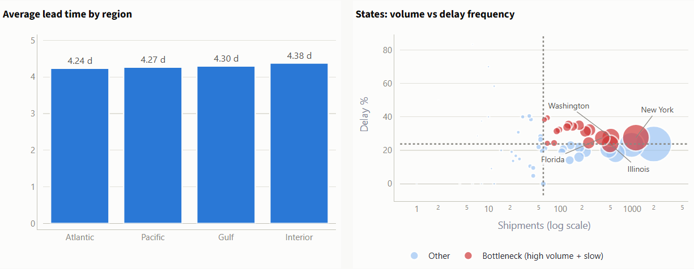

### 3 · Ship Mode Comparison
Lead-time distribution by mode against the delay threshold, standard vs expedited KPIs, the descriptive cost-time trade-off, and a mode × region heatmap.

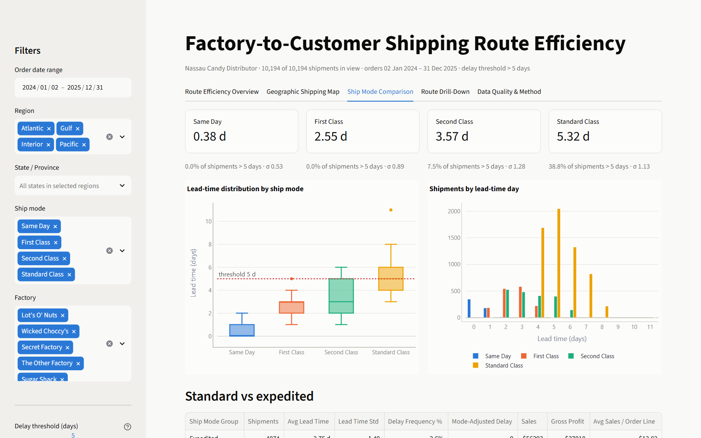
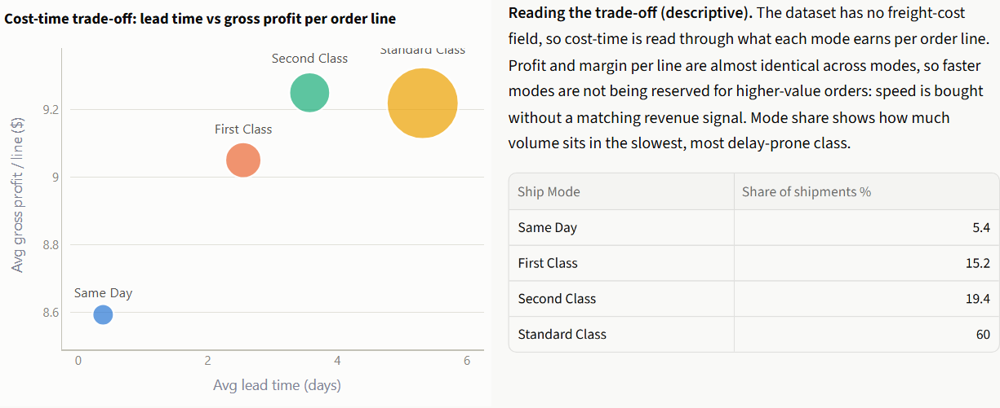

### 4 · Route Drill-Down
State-level KPIs, factory × mode breakdown, city performance, and an **order-level shipment timeline** for any route, with CSV export.

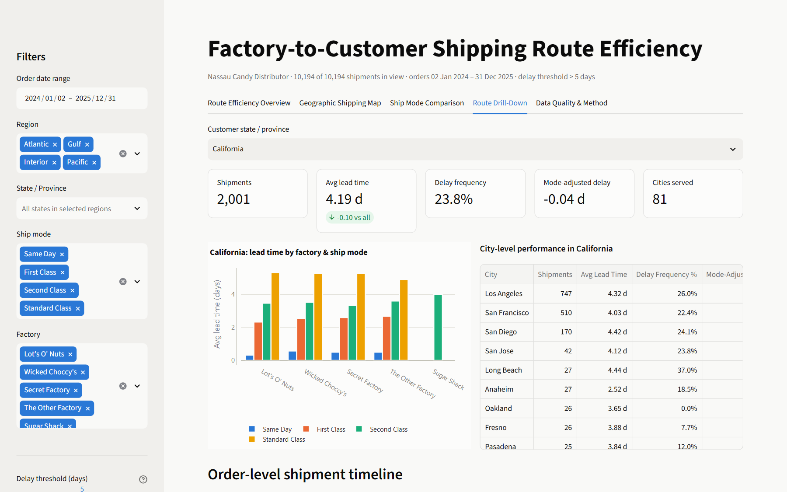
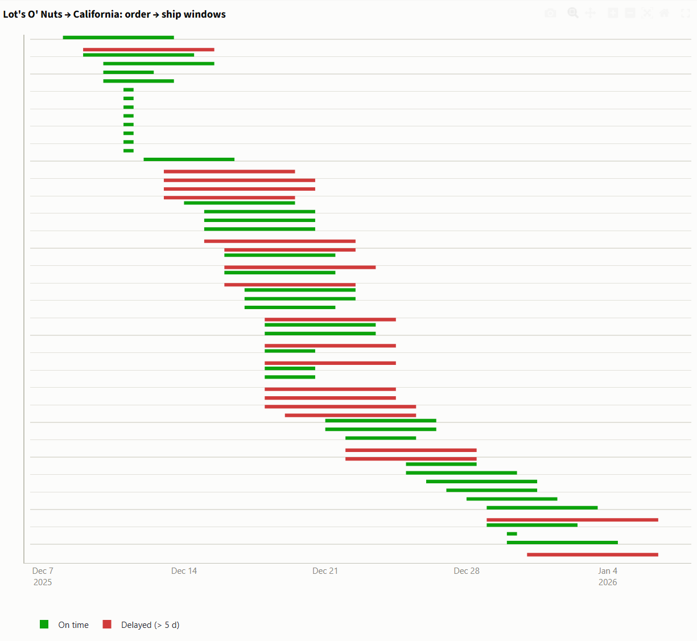

### 5 · Data Quality & Method
The cleaning log, the lead-time correction evidence and KPI definitions, kept inside the app for transparency.

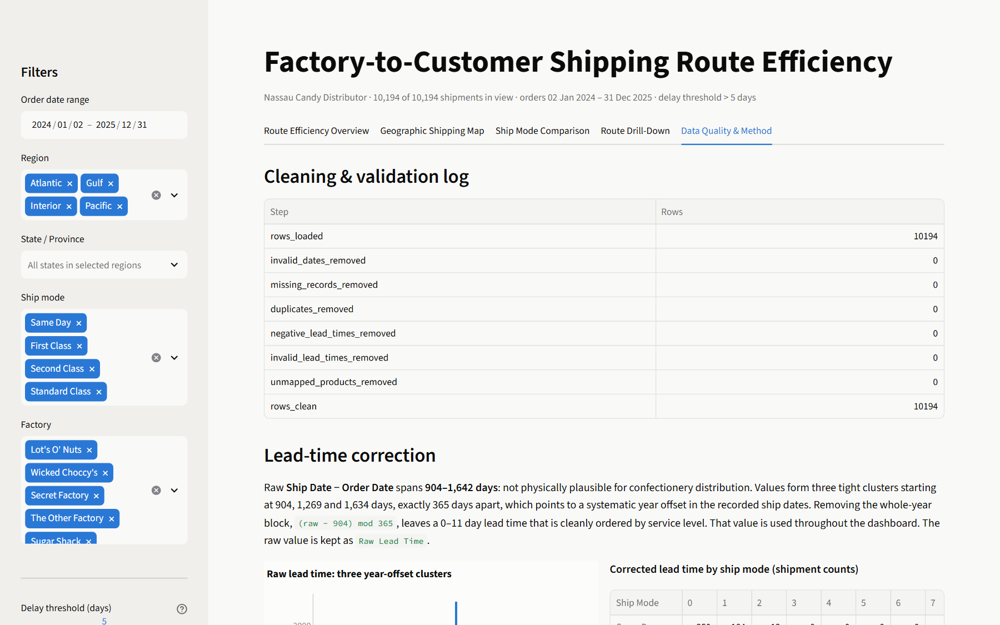

---

## Methodology

1. **Cleaning and validation:** parse DD-MM-YYYY dates; drop invalid dates, missing shipment records, duplicates and negative lead times; standardise geographic and product text; map each state/province to a code and centroid.
2. **Lead-time correction:** `Lead Time = (Raw − 904) mod 365`. The raw value is kept as `Raw Lead Time` for audit.
3. **Feature engineering:** product → factory mapping (from the brief), factory coordinates, factory → state great-circle distance, route keys (Factory → State / Region), standard vs expedited grouping, and **mode-adjusted delay** (lead time minus the same ship mode's average) so geographies are compared fairly.
4. **Route aggregation:** per route, compute volume, mean/median lead time, variability, delay frequency and efficiency score. Rankings require a minimum number of shipments (default 20).
5. **Benchmarking and bottlenecks:** top/bottom 10 routes; states flagged when volume ≥ median **and** lead time or delay rate > median; a Bottleneck Index (volume share × delay rate).
6. **Statistics:** Kruskal-Wallis (region, state, factory, mode), Mann-Whitney (2024 vs 2025), Spearman (distance), and a mix-adjusted year-over-year comparison.

## KPIs

| KPI | Definition |
|---|---|
| Shipping Lead Time | Ship Date − Order Date (year-offset corrected), days |
| Average Lead Time | Mean lead time per route |
| Route Volume | Order lines per route |
| Delay Frequency | % of shipments with lead time > threshold (default 5 days, adjustable) |
| Route Efficiency Score | `100 × (slowest avg − route avg) / (slowest avg − fastest avg)` across ranked routes |
| Mode-Adjusted Delay | Lead time − mean lead time of the same ship mode |
| Bottleneck Index | Share of volume × delay rate, scaled to 100 |

---

## Getting started

```bash
git clone https://github.com/mahak867/nassu-dashboard.git
cd nassu-dashboard
pip install -r requirements.txt
streamlit run app.py
```

The dashboard opens at `http://localhost:8501`.

To regenerate the research paper, executive summary, figures and KPI tables:

```bash
pip install python-docx matplotlib
python build_report.py
```

## Project structure

```
├── app.py                 # Streamlit dashboard (5 modules)
├── analysis.py            # Cleaning, lead-time correction, feature engineering, KPI functions
├── build_report.py        # Generates paper, executive summary, figures and tables from the data
├── data/
│   └── nassau_candy.csv   # Source order data
├── reports/
│   ├── Nassau_Candy_Route_Efficiency_Research_Paper.docx
│   ├── Nassau_Candy_Executive_Summary.docx
│   ├── figures/           # Static charts used in the paper
│   └── tables/            # Route, state, region, ship-mode KPIs; bottlenecks; cleaned dataset
├── docs/screenshots/      # Dashboard screenshots
├── .streamlit/config.toml # Theme
└── requirements.txt
```

## Deliverables

| Deliverable | Location |
|---|---|
| Research paper (EDA, insights, recommendations) | [`reports/Nassau_Candy_Route_Efficiency_Research_Paper.docx`](reports/Nassau_Candy_Route_Efficiency_Research_Paper.docx) |
| Executive summary for government stakeholders | [`reports/Nassau_Candy_Executive_Summary.docx`](reports/Nassau_Candy_Executive_Summary.docx) |
| Streamlit dashboard (live analytics) | [`app.py`](app.py) |
| KPI tables (CSV) | [`reports/tables/`](reports/tables) |

## Limitations

- The lead-time correction treats the year offset as a recording artefact. The clean ship-mode ordering strongly supports this, but it should be confirmed with operations.
- Lead time measures order-to-dispatch, not delivery; the data has no delivery date.
- The data has no freight-cost or carrier field, so the cost-time trade-off is descriptive.
- Distance uses state centroids rather than exact customer addresses.
- Low-volume factory flows (Sugar Shack, The Other Factory, Secret Factory) give noisy route estimates; the minimum-shipment rule keeps them out of the rankings.

---

**Author:** Mahak Fahad ([@mahak867](https://github.com/mahak867)). Internship project: *Factory-to-Customer Shipping Route Efficiency Analysis for Nassau Candy Distributor*.
